<p align="center"></p>

# MediConnect

**Connected workflows for care.**

[Development](#local-development) · [Stack](#stack)

<table><tr><td width="33%" valign="top"><h3>Explore the platform</h3><p>Public product pages and a demo sandbox.</p></td><td width="33%" valign="top"><h3>Navigate operations</h3><p>Patient, bed, inventory, and transfer interfaces.</p></td><td width="33%" valign="top"><h3>Inspect the backend</h3><p>Prisma models and authenticated API routes.</p></td></tr></table>

A healthcare web prototype with public product pages, a demo sandbox, dashboard screens, and API routes for hospital operations.

## Explore

| Area | Included surfaces |
| :--- | :--- |
| Public site | Product, pricing, about, contact, demo |
| Dashboard | Patients, beds, inventory, emergencies, reports, settings |
| Backend | Authentication, hospital and patient routes, transfers |
| Data model | Hospitals, users, admissions, inventory, records, consent |

The demo sandbox uses mock data. Real-time synchronization was listed as planned in the previous documentation.

## Stack

Next.js 16 · React 19 · TypeScript · Tailwind CSS · Framer Motion · NextAuth · Prisma · PostgreSQL

## Local development

```bash
git clone https://github.com/begoneeraj/MediConnect.git
cd MediConnect
npm ci
```

Create a local `.env` file; no environment template is currently committed.

| Variable | Purpose |
| :--- | :--- |
| `DATABASE_URL` | Database connection; review the note below |
| `AUTH_SECRET` | NextAuth session secret |
| `GOOGLE_CLIENT_ID` | Google OAuth client ID |
| `GOOGLE_CLIENT_SECRET` | Google OAuth secret |

**Database configuration:** `prisma.config.ts` uses `DATABASE_URL` for the CLI datasource, while `lib/prisma.ts` passes it as an Accelerate URL at runtime. Review these connection requirements before configuring a local database.

After configuring the connection:

```bash
npx prisma generate
npx prisma db push
npm run dev
```

Open **http://localhost:3000**. Google sign-in also requires matching callback URLs in the Google project. Run `npm run build` to check a production build after configuring the environment.

## Repository map

```text
app/                  Public pages, dashboard, and API routes
lib/auth.ts           Authentication and session callbacks
lib/prisma.ts         Runtime database client
prisma/schema.prisma  Data models
prisma.config.ts      Prisma CLI configuration
middleware.ts         Route protection
```

## Development status

The repository currently has no Dockerfile, license file, or seed script. Document deployment, licensing, and demo-data setup when those artifacts are added.
